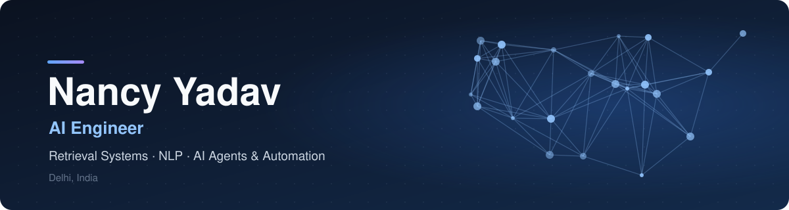
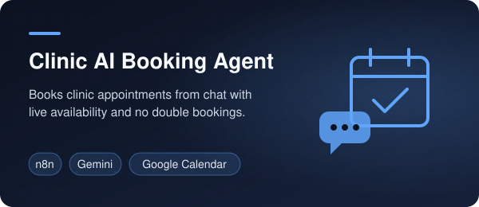
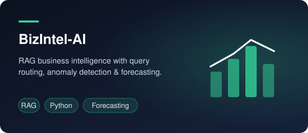
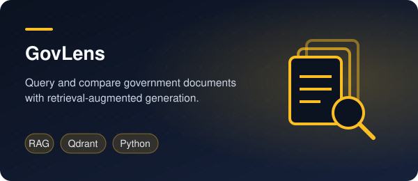
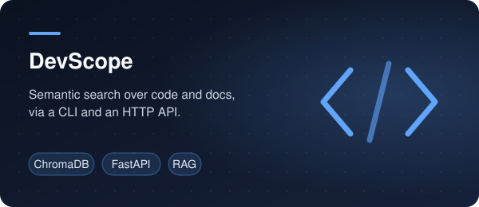
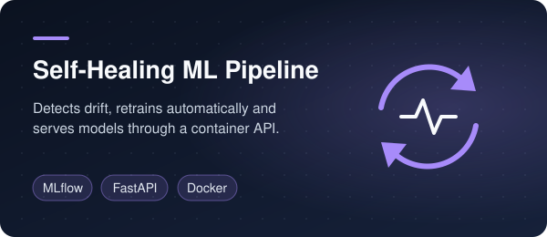
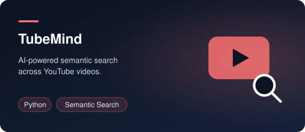

  

## About Me

I'm a Computer Science undergraduate and AI engineer who builds intelligent systems that work reliably outside the notebook. My work spans **retrieval-augmented generation**, **natural language processing** and **AI-driven automation**: from semantic search engines over code and government documents to an AI agent that books clinic appointments end to end.

I care about the details that make AI usable in production: grounded answers, validated model output, idempotent pipelines, and failure handling that never misleads the user.

- **Currently:** building AI agents and workflow automations with n8n and LLMs
- **Interests:** RAG and semantic search · NLP · AI agents · MLOps
- **Open to:** AI engineering and automation roles

## Tech Stack

  

  <b>AI & NLP</b> — Hugging Face Transformers, Sentence Transformers, BERT, spaCy, NLTK, Gemini 
  <b>Retrieval</b> — RAG, ChromaDB, Qdrant, vector embeddings, dense retrieval 
  <b>Automation & MLOps</b> — n8n, AI agents, webhooks, REST APIs, Google Calendar API, WhatsApp Cloud API, Apache Airflow, MLflow, Streamlit

## Featured Projects

  
  

  
  

  
  

## Let's Connect

  
  &nbsp;
  
  &nbsp;
  

